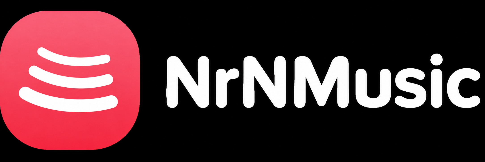

NrNMusic

Aesthetic Music Experience

A modern Android music player with a beautiful interface, powerful audio capabilities, and a highly customizable listening experience.

 "Platform" (https://img.shields.io/badge/Platform-Android-3DDC84?style=flat-square&logo=android&logoColor=white)
"License" (https://img.shields.io/badge/License-GPL--3.0-blue?style=flat-square)
"Project" (https://img.shields.io/badge/Project-NrNMusic-8A63D2?style=flat-square)

---

✦ About NrNMusic

NrNMusic is an independent Android music player built around three essential ideas: aesthetics, flexibility, and audio quality.

It combines online music streaming, local playback, synchronized lyrics, advanced audio processing, and a carefully designed interface into one unified experience.

From casual listening to advanced audio configurations, NrNMusic aims to make every listening session feel personal.

---

✧ Features

<table>
<tr>
<td width="50%" valign="top">🎵 Music & Playback

- Search, browse, and play YouTube Music content.
- Hi-Res lossless audio through configurable module sources.
- Gapless playback.
- True crossfade with adjustable duration (0–12s).
- Automix with beat-matching and tempo-stretching (Beta).
- Offline downloads with embedded metadata.
- Local music library integration.
- Background playback with foreground media sessions.

🎧 Audio Controls

- Independent Wi-Fi and mobile data quality settings.
- Playback speed control (0.5x–2.0x).
- Skip silence.
- Sleep timer.
- System equalizer integration.
- Bit-perfect USB exclusive output.
- Audio statistics and playback information.

</td>
<td width="50%" valign="top">🎨 Visual Experience

- Animated album artwork.
- Word-synchronized lyrics.
- Multiple lyrics providers.
- Dynamic artwork-based Material theming.
- Frosted-glass interface.
- Material 3 design system.
- Animated lyrics interface.

🌐 Integrations

- Google account authentication.
- Spotify integration.
- Discord Rich Presence.
- Last.fm scrobbling.
- ListenBrainz scrobbling.
- Configurable external music sources.
- Source testing and health monitoring.

</td>
</tr>
</table>---

◈ Audio Experience

NrNMusic supports multiple playback environments and audio configurations.

Capability| Description
Online Streaming| Music playback through supported online sources
Local Playback| Access to music stored on the device
Lossless Audio| External module-based lossless sources
Gapless Playback| Continuous playback between tracks
Crossfade| Adjustable transitions between songs
USB Exclusive| Direct bit-perfect output to supported USB DACs
Lyrics| Synchronized lyric presentation
Automix| Intelligent music transitions (Beta)

---

◈ Design Philosophy

NrNMusic is designed with attention to both functionality and visual consistency.

01. Minimalism

A clean interface that prioritizes the music and its artwork.

02. Personalization

Customizable themes, audio settings, and music sources.

03. Performance

Responsive playback and efficient resource utilization.

04. Extensibility

A modular approach that allows additional integrations and capabilities.

---

◈ Project Architecture

The application brings together several independent components:

NrNMusic
│
├── Music Sources
│   ├── Online Streaming
│   ├── External Modules
│   └── Local Library
│
├── Playback Engine
│   ├── Audio Processing
│   ├── Gapless Playback
│   ├── Crossfade
│   └── Automix
│
├── Music Experience
│   ├── Lyrics Synchronization
│   ├── Album Artwork
│   └── Dynamic Theming
│
├── Integrations
│   ├── Google
│   ├── Spotify
│   ├── Discord
│   └── Scrobbling Services
│
└── Audio Configuration
    ├── Equalizer
    ├── USB Exclusive Output
    └── Playback Statistics

---

⚖️ Disclaimer

NrNMusic is an independent, community-driven third-party audio player.

It is not affiliated with, endorsed by, or officially connected to Google LLC, YouTube Music, Spotify, Deezer, Telegram, or their respective parent companies.

- Media Hosting: NrNMusic does not host or distribute copyrighted music files. It accesses media through supported sources and local device storage.
- API Usage: Users are responsible for ensuring their usage complies with applicable terms of service and copyright laws.
- Third-Party Services: External integrations may change or become unavailable independently of NrNMusic.
- Trademarks: All third-party trademarks and services remain the property of their respective owners.

---

📜 License

NrNMusic is licensed under the GNU General Public License v3.0 (GPL-3.0).

All distributions and modifications must comply with the terms of this license.

---

NrNMusic

Music is more than sound. It's an experience.

Made with passion.

